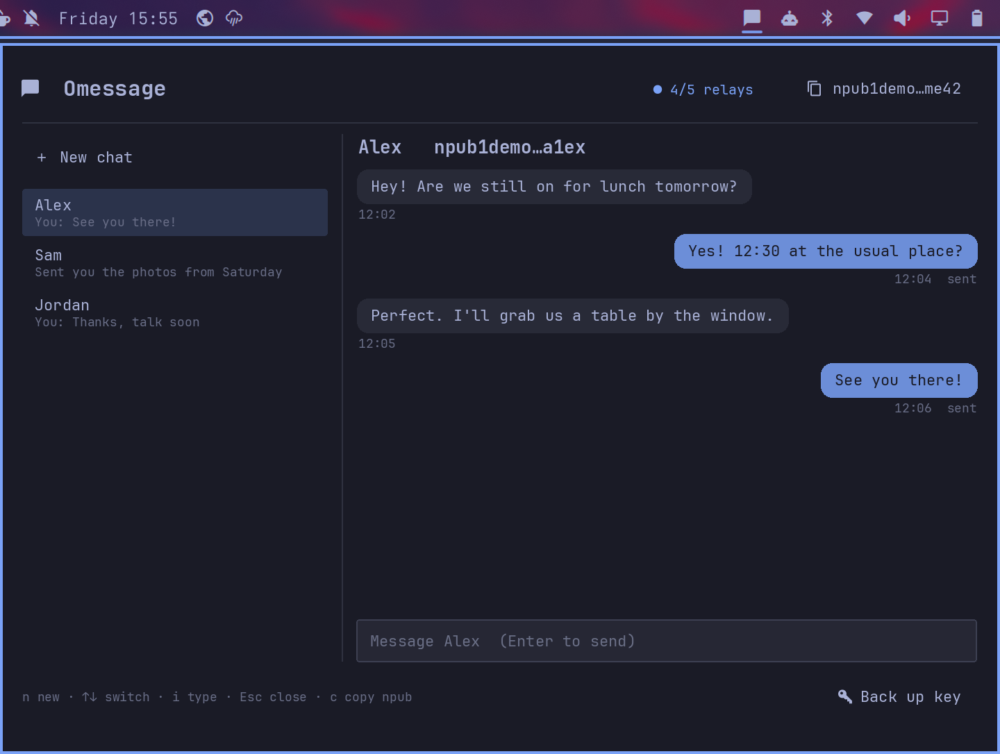

<div align="center">

# 󰍡 Omessage

**Private, end-to-end encrypted messaging built into your Omarchy bar.**



</div>

Omessage is an iMessage-style messenger for [Omarchy](https://omarchy.org). Your
Omarchy install *is* your account: the first time it runs, it creates a Nostr
identity for this device, and you chat with people by their npub. There's no
sign-up, phone number or email, and no server of ours in the middle.

## Features

- **End-to-end encrypted DMs.** Messages are Nostr private direct messages
  ([NIP-17](https://github.com/nostr-protocol/nips/blob/master/17.md): NIP-44
  encryption inside NIP-59 gift wraps). Relays can't read them or see who sent
  them.
- **Per-device identity.** A key is created on first run and never leaves the
  machine unless you back it up.
- **Unread badge in the bar.** Left click opens the chat panel, middle click
  starts a new chat, right click marks everything read.
- **Chat panel.** Conversation list, threads, compose, and new chats by npub
  or NIP-05 address (`name@example.com`). Keyboard first: `n` new chat,
  `↑/↓` or `j/k` switch, `i` type, `c` copy your npub, `Esc` close.
- **Message requests and blocking.** Messages from people who aren't in your
  contacts wait under **Requests**, where you can accept, block or delete them.
- **Desktop notifications** for new messages.
- **No account needed.** It's plain Nostr, so you can also talk to people on
  other NIP-17 apps (0xchat, Amethyst and others).

## Install

Requirements: Omarchy with the Quattro shell, plus a systemd user session,
`notify-send`, `curl` and `wl-copy`. These all ship with Omarchy.

**1. Add the plugin:**

```bash
omarchy plugin add https://github.com/Omarchy-Omessage/omarchy-omessage --enable
```

**2. Install the helper.** Omessage needs a small background service,
`omessaged`, which holds your key, talks to the relays and stores messages.
Pick one option:

- **Build it from source** (needs Rust 1.89 or newer, e.g. `sudo pacman -S rust`;
  the first build takes a few minutes):

  ```bash
  ~/.config/omarchy/plugins/io.github.omarchy-omessage.omessage/install.sh
  ```

  The **Install helper** button in the panel runs this same script in a
  terminal.

- **Use the prebuilt x86_64 binary** from the
  [latest release](https://github.com/Omarchy-Omessage/omarchy-omessage/releases/latest):

  ```bash
  cd /tmp
  curl -fLO https://github.com/Omarchy-Omessage/omarchy-omessage/releases/latest/download/omessaged-x86_64-linux
  curl -fLO https://github.com/Omarchy-Omessage/omarchy-omessage/releases/latest/download/omessaged-x86_64-linux.sha256
  sha256sum -c omessaged-x86_64-linux.sha256
  chmod +x omessaged-x86_64-linux
  OMESSAGE_HELPER_BIN=/tmp/omessaged-x86_64-linux \
    ~/.config/omarchy/plugins/io.github.omarchy-omessage.omessage/install.sh
  ```

`install.sh` copies the helper to `~/.local/share/omessage/bin/`, installs and
starts the `omessaged` user service, and prints your npub. No sudo is needed,
and it doesn't change any Omarchy configuration. After `omarchy plugin update`,
run `install.sh` again to update the helper.

## Usage

1. Click the 󰍡 icon in the bar.
2. Click your npub in the header (or press `c`) to copy it, then share it with
   friends.
3. Press `n`, paste a friend's npub or NIP-05 address, optionally add a name,
   and press Enter.

**Message requests.** Anyone who knows your npub can write to you, so messages
from people who aren't in your contacts go under **Requests**:

- A request shows only the sender's short npub. Their self-chosen profile name
  is never shown (or even fetched) until you accept, so nobody can pose as
  "Mom".
- A new request raises one generic "New message request" notification with
  none of the sender's text. It doesn't count toward the unread badge; the
  bar shows a dot instead.
- **Accept** moves the sender to your conversations, **Block** deletes the
  request and silently drops their future messages, and **Delete** removes it
  (they can write again).
- Requests are capped at 50 senders with 20 messages each, oldest first out.

Starting a chat with someone, or replying, accepts them. A message that no
relay accepted shows "not delivered · retry"; click it to send it again.

**Back up your key.** Your identity lives only on this device. **Back up key**
(click twice to confirm) writes your `nsec` to
`~/omessage-key-backup-<id>.txt` with mode `0600`, or run
`omessaged export-key --out <path>`. Anyone with it can read your messages and
send as you. To restore on a fresh install, stop the service and run
`omessaged import-key < backup.txt` before starting it again.

### Command line

```
omessaged id                                 your npub
omessaged send <npub|nip05> <text>           send a message
omessaged add <npub|nip05> [name]            add a contact
omessaged accept|block|unblock|delete <npub>
omessaged retry <message-id>                 resend a failed message
omessaged snapshot                           JSON state
```

### Relays

Relays are set in `~/.config/omessage/config.json`:

```json
{
  "relays": ["wss://relay.damus.io", "wss://nos.lol", "wss://relay.primal.net"],
  "inbox_relays": ["wss://relay.damus.io", "wss://nos.lol"],
  "discovery_relays": ["wss://purplepag.es", "wss://relay.nos.social"],
  "notifications": true
}
```

`inbox_relays` is published as your NIP-17 DM relay list (kind 10050), so other
clients know where to deliver to you. Outgoing messages go to the recipient's
kind 10050 relays, then their NIP-65 read relays, then your own relays. A copy
of each message is also wrapped to you and kept on your inbox relays. Restart
the service after editing (`systemctl --user restart omessaged`).

A self-hosted, always-on Omessage relay is planned. You can already run your
own: put its `wss://` URL first in `inbox_relays`.

## Privacy and security

- **What relays see.** Relays store encrypted gift wraps addressed to your
  npub, with randomized timestamps. They can't read the content or see who
  sent a message, but they do see your IP address, which npub a wrap is for,
  and roughly how large it is. Your kind 10050 inbox relay list is public.
  Omessage publishes only that list and gift-wrapped DMs; it never posts
  public notes.
- **Other lookups.** Profiles of your accepted contacts are fetched from
  relays, and NIP-05 addresses are looked up with `curl` on the address's own
  domain.
- **Your key** is stored unencrypted (hex) in
  `~/.local/share/omessage/identity.key` with mode `0600`, next to the message
  database (also `0600`). Anyone with access to your user account can read
  both. NIP-17 has no forward secrecy: if the key leaks, past messages can be
  decrypted.
- **Local only.** No telemetry, analytics or third-party servers beyond the
  Nostr relays you configure. Messages are stored only on this device and on
  relays.
- **Not sandboxed.** Like every Omarchy plugin, the QML runs inside your shell
  with your user's permissions, and the helper runs as your systemd user
  service. Review the code before installing.
- Untrusted text (messages, names) is rendered as plain text and sanitized
  before it reaches notifications. Messages are limited to 16 KiB.

## How it works

```
 Omarchy shell (QML plugin)  ──omessaged watch / send──▶  omessaged (systemd --user)
   BarWidget.qml, Panel.qml        unix socket in            keys · relays · NIP-17
                                   $XDG_RUNTIME_DIR           SQLite · notify-send
                                                                   │
                                                          wss:// Nostr relays
```

- **Plugin** (`BarWidget.qml`, `Panel.qml`, `Model.js`): a `bar-widget` with a
  built-in chat panel. It runs no network code itself: it streams state from
  `omessaged watch` and runs `omessaged <command>` to act.
- **Helper** (`helper/`, Rust, [nostr-sdk](https://crates.io/crates/nostr-sdk)):
  keeps relay connections, unwraps incoming gift wraps, stores messages in
  SQLite, publishes your inbox relay list and sends notifications through
  `notify-send`.

| Path | What |
|------|------|
| `~/.local/share/omessage/identity.key` | This device's secret key (hex), mode `0600` |
| `~/.local/share/omessage/messages.db` | Local message store, mode `0600` |
| `~/.local/share/omessage/bin/omessaged` | The helper binary |
| `~/.config/omessage/config.json` | Relay settings |
| `~/.config/systemd/user/omessaged.service` | The user service |
| `$XDG_RUNTIME_DIR/omessage/omessaged.sock` | Control socket (owner only) |

## Uninstall

```bash
~/.config/omarchy/plugins/io.github.omarchy-omessage.omessage/uninstall.sh
omarchy plugin remove io.github.omarchy-omessage.omessage
```

`uninstall.sh` stops and disables the service and removes the unit file and the
helper binary. Your identity and messages stay in `~/.local/share/omessage`.
Run `uninstall.sh --purge` to delete them too (it asks first; add `--yes` to
skip the question). Back up your key before purging if you may want this
identity again.

## Build from source

```bash
git clone https://github.com/Omarchy-Omessage/omarchy-omessage
cd omarchy-omessage/helper
cargo build --release --locked     # Rust 1.89+
cargo test --release --locked
```

`install.sh` does the same build in `~/.cache/omessage/target` and installs the
result. Cargo fetches the crates pinned in `helper/Cargo.lock` (nostr-sdk,
rusqlite with bundled SQLite, tokio, serde).

## Limitations

- One-to-one chats only, text only: no groups, attachments, reactions or read
  receipts yet.
- One device per identity. Importing the same key on a second machine works,
  but there's no device-linking UI.
- "Omarchy-only" is about distribution, not enforcement: the plugin runs inside
  the Omarchy shell, but the protocol is open Nostr.

## License

[MIT](LICENSE) © Bryan Hayes
